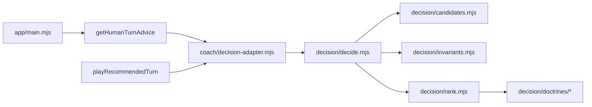

# 掼蛋教练 Pro — 架构

## 设计原则

1. **规则与决策分离**：`engine` 只回答「能不能出、谁更大」；**产品 Top1** 由 `decision/` 统一内核回答。
2. **评分可解释**：decision 输出 `evidence` / 理由；问教练仍大量依赖 `strategy/principles.mjs` 与 `coach/local-qa.mjs`。
3. **产品形态不变**：四人桌、你+队友 AI、即时建议、导出、问教练。

## 数据流（产品路径）

## 遗留策略层（`strategy/`）

仍用于：教纲 enforcement、部分教纲回归（`recommendPlay` / `getTurnAdvice`）、应急 `humanAdviceFallback`、策略审计、ML 融合。  
**新功能默认改 `decision/`，不要只改 `strategy/recommend.mjs`  expecting UI 变化。**

| 模块 | 职责 |
|------|------|
| `decision/decide.mjs` | 产品 Top1；`DECISION_CORE_REVISION` |
| `strategy/recommend.mjs` | 遗留评分池与 audit；与产品可能对齐测试 |
| `strategy/principles.mjs` | P1–P12 教纲字面与问教练 |
| `coach/local-qa.mjs` | 问教练规则引擎 |

## 扩展方向

- Golden / 门禁与产品对齐：`tests/lib/product-advice.mjs`
- 从导出 JSON 增加回归（`tests/fixtures/`）
- 自博弈审计（`tools/audit-strategy.mjs`）
- **数据流水线 P0**：见 [DATA-PIPELINE.md](./DATA-PIPELINE.md)

Agent 详见根目录 [AGENTS.md](../AGENTS.md)。
